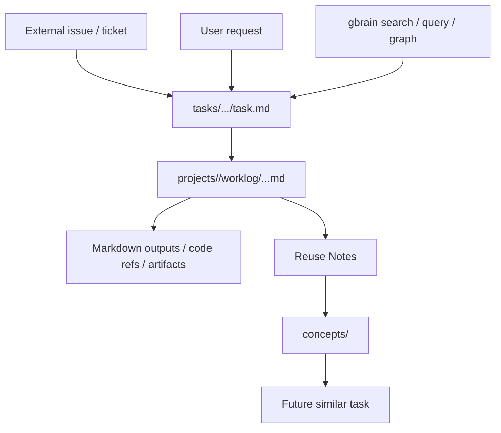
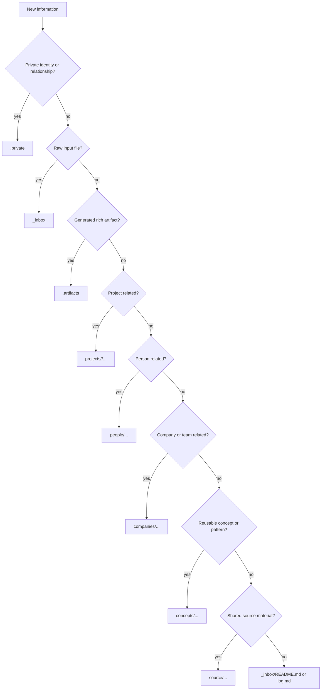

# Work Knowledge Vault Design

作成日: 2026-05-25
状態: Draft

## 目的

この設計書は、Agent が仕事の knowledge を継続的に蓄積・参照するための `work` knowledge vault を定義する。

全体構成では `personal` と `work` を別 brain として分ける。本設計では先に `work` 側を具体化し、プロジェクト、会議、資料、意思決定、タスク対応履歴、再利用可能な知識を扱う。

この vault は gbrain base / recommended schema を基本的に踏襲する。Markdown を source of truth とし、gbrain は検索、リンク抽出、知識グラフ、MCP / Agent 連携のレイヤーとして扱う。

技術アーキテクチャ、DB、embedding、runtime integration の方針は [Work GBrain Architecture](./work-gbrain-architecture.md) を正とする。

## 基本方針

- `personal` と `work` は別 brain とする。
- `work` brain は初期単一 source とする。
- gbrain base を clone / initialize し、work 固有の overlay だけを追加する。
- top-level directory は gbrain canonical を優先する。
- 1 Markdown file を 1 brain page として扱う。
- 各 brain page は compiled truth + timeline に寄せる。
- 内部リンクは Obsidian-style wikilink を基本とする。
- raw 原本、private 情報、リッチ成果物は通常の gbrain sync / extract 対象にしない。
- `projects/` は外部 repo から symlink 可能な軽量 working knowledge layer とする。
- 外部 issue / SharePoint / Teams / mail など外部システムへの書き込みはユーザー承認制とする。

## Top Level Structure

```text
knowledge/
  personal/
  work/
    RESOLVER.md
    schema.md
    ACCESS_POLICY.md
    index.md                       # 人間向け目次。gbrain index 対象外。
    log.md

    templates/
      pages/
        meeting.md.template
        source.md.template
        worklog-task.md.template
      documents/
        word/
        powerpoint/
        excel/

    _inbox/
      README.md
      intake-log.md

    .raw/
      projects/

    .artifacts/
      projects/

    .private/
      identity-map.md
      relationship-map.md
      access-policy.md

    projects/
    people/
    companies/
    meetings/
    decisions/
    concepts/
    source/
    archive/
```

### Directory Responsibilities

- `RESOLVER.md`: Agent が保存先を決めるための入口。新規ページ作成前に読む。
- `schema.md`: page type、frontmatter、page template の定義。
- `ACCESS_POLICY.md`: `.private`、`.raw`、外部 LLM、外部システム書き込み、匿名化のルール。
- `index.md`: 人間向けの目次。
- `log.md`: vault 全体の重要な整理、移動、方針変更の記録。
- `templates/pages/`: Markdown brain page のテンプレート。
- `templates/documents/`: Word / PowerPoint / Excel などの生成テンプレート。
- `_inbox/`: 未処理情報の投入場所。処理済み情報の保管場所にはしない。
- `_inbox/`: ユーザーが雑に置く未処理 raw。投入時点で project 分類は求めない。
- `.raw/`: 入力原本、受領資料、transcript、user notes、Copilot summary などの保管場所。文書資料は論理資料単位で最新版だけを保持する。
- `.artifacts/`: Agent が生成した Word / Excel / PowerPoint / PDF / 画像 / zip などのリッチ成果物の保管場所。
- `.private/`: 実名対応、関係性、優先度判断などの非公開補助コンテキスト。
- `projects/`: プロジェクト単位の working knowledge。
- `people/`: 匿名化された関係者ページ。
- `companies/`: 会社、部署、チーム、外部組織。gbrain canonical に合わせる。
- `meetings/`: プロジェクト横断の会議インデックス。実体は原則 project-local。
- `decisions/`: プロジェクト横断の重要意思決定。通常は project-local decisions を優先する。
- `concepts/`: 複数プロジェクト・複数タスクにまたがって再利用できる抽象知識、設計パターン、判断基準。
- `source/`: 複数プロジェクトで共有する加工済み資料や参照情報。gbrain canonical に合わせて単数形にする。
- `archive/`: 終了プロジェクトや使わなくなった情報の退避先。

## gbrain Compatibility

この設計は gbrain の以下の運用を前提にする。

- `RESOLVER.md` を filing decision tree として使う。
- 各 directory の `README.md` を local resolver として使う。
- `[[path]]` / `[[path|Display]]` の wikilink を graph edge の入口として使う。
- frontmatter で typed relation を補助する。
- `.raw` と `*.raw` は通常の sync / extract 対象から外す。
- compiled truth を page 上部に、timeline を page 下部に置く。
- runtime は local PGLite + local `native-ruri` embedding を使い、hosted provider を初期設定しない。

gbrain base との差分は work 固有の制約だけにする。

- work と personal は別 brain。
- work は初期単一 source。
- raw 原本は `.raw/`、生成 artifact は `.artifacts/`、非公開情報は `.private/` に分ける。
- work brain は外部 LLM 送信禁止をデフォルトにする。
- 実名は public brain に原則書かず、role-based pseudonym を使う。
- 外部 repo から symlink するのは `projects/<project>/` のみ。
- docs-processing は v1 では専用 local chat LLM ではなく、ユーザー指示を受けた coding-agent / human-in-the-loop による明示処理とする。

### gbrain Investigation Notes

確認した gbrain 実装・ドキュメント上の前提は以下。

- `RESOLVER.md` は、新しい情報をどこに保存するかを Agent が判断するための filing rule として使われる。
- `[[path]]` と `[[path|Display]]` の wikilink は graph edge の入口になる。
- `[[source-id:path]]` のような source-qualified wikilink も扱える。
- Markdown link、wikilink、frontmatter は link candidate として抽出され、page 間の edge に変換される。
- `.raw`、`*.raw`、dot directory、`ops` は通常の sync / extract から除外されうる。
- gbrain の task manager は `ops/tasks.md` を使うが、これは work overlay の project knowledge とは別の operational state として扱う。

## Link Policy

### Internal Links

内部リンクは Obsidian-style wikilink を基本とする。

```md
[[projects/foo/overview]]
[[projects/foo/worklog/2026/05/2026-05-25/01-basic-design|基本設計書作成]]
[[people/dev-a|Dev A]]
[[companies/client-a|Client A]]
[[meetings/index]]
[[concepts/document-intake-pipeline]]
```

gbrain の edge 抽出は top-level directory whitelist の影響を受けるため、初期は `projects/`, `people/`, `companies/`, `meetings/`, `concepts/`, `source/` を中心に使う。

### External Links

外部 URL は通常の Markdown link を使う。

```md
[SharePoint document](https://example.sharepoint.com/...)
```

access URL、token、credential は brain page に書かない。

### Raw and Artifact References

raw 原本やリッチ成果物は wikilink ではなく metadata と ref で参照する。

```yaml
raw_refs:
  - raw://work/projects/foo/meetings/weekly-sync/2026/05/2026-05-25-1030-weekly-sync
artifact_refs:
  - artifact://work/projects/foo/worklog/2026/05/2026-05-25/01-basic-design/basic-design.docx
```

## Page Model

主要 page は gbrain の compiled truth + timeline に寄せる。

```md
---
type: project
status: active
aliases: []
tags: []
---

# Page Title

## Current State

Agent が最初に読む現在の理解。

## Open Threads

未解決の論点、リスク、待ち、確認事項。

## Links

関連ページ。

<!-- timeline -->

- **2026-05-25** | Source — 何が起きたか。
```

timeline は append-only を基本とする。compiled truth は新しい根拠に基づいて Agent が更新する。根拠が薄い推測は `Open Questions` または `Candidates` に置く。

## Project Model

project は gbrain entity page として扱う。

```text
小さい project:
  projects/<project>.md

大きい project:
  projects/<project>/overview.md
```

project が大きくなった場合のみ folder 化し、必要な subpage を追加する。

```text
projects/<project>/
  overview.md
  decisions.md
  meetings/
  tasks/
  worklog/
  operations/
  sources/
```

- `decisions.md`: project ごとの意思決定ログ。大きな decision だけ将来個別 page 化する。
- `meetings/`: project-local meeting note。
- `tasks/`: 外部 issue / ticket の local context。
- `worklog/`: Agent が実際に対応した作業履歴。
- `operations/`: project から発生したが、成果物が project 本体ではない効率化・運用改善・補助ツール作成。
- `sources/`: project に紐づく加工済み資料 knowledge。raw 原本は置かない。

文書資料は docs-processing により論理資料単位へ集約する。`v1`、`v2`、`(1)` などの版違い、再ダウンロード、コピー suffix 付きファイルを別資料として増やさない。

```text
.raw/projects/<project>/documents/02-基本設計/
  基本設計書/
    基本設計書_v2.xlsx
    metadata.json

projects/<project>/sources/documents/02-基本設計/
  基本設計書/
    overview.md
    extracted/
      基本設計書/
        sheet-概要.md
        sheet-画面一覧.md
    views/
      基本設計書/
        yymmdd_summary.md
    metadata.json
```

raw 原本は投入時のファイル名を維持する。旧版本体と重複本体は残さず、置換履歴を `.raw/.../metadata.json` に記録する。`overview.md` は source の入口、`extracted/<file-stem>/*.md` は docs-processor の抽出結果、`views/<scope>/yymmdd_<slug>.*` は人間用 view として扱う。

`ops/` は gbrain walker で除外される可能性があるため、project 配下でも `operations/` を使う。

## Meeting Model

meeting は project ごとに管理する。会議後の出力物は 1 meeting 1 file にまとめる。

```text
projects/<project>/meetings/<meeting-name>/YYYY/MM/YYYY-MM-DD-HHMM-<meeting-name>.md
```

時間不明の場合のみ以下を許容する。

```text
projects/<project>/meetings/<meeting-name>/YYYY/MM/YYYY-MM-DD-<meeting-name>.md
```

`meeting-name` はユーザー、calendar、transcript title などの文脈から決める。定例会議だと分かる場合は定例名、単発会議はその日の title に寄せる。不明な場合は無理に既存会議体へ分類しない。

会議の一次情報は `.raw` に置く。一次情報の種類は transcript だけに限定しない。

```text
.raw/projects/<project>/meetings/<meeting-name>/YYYY/MM/
  YYYY-MM-DD-HHMM-<meeting-name>.transcript.md
  YYYY-MM-DD-HHMM-<meeting-name>.user-notes.md
  YYYY-MM-DD-HHMM-<meeting-name>.copilot-summary.md
  metadata.json
```

meeting note は必要な章だけ出す。空欄を埋めるための推論は禁止する。

```md
## Summary
## Notes
## Decisions
## Action Items
## Risks
## Follow-ups
## Open Questions
## Entity Updates
```

該当情報がない章は作らない。決定事項と候補は混ぜない。Action Item は担当者、期限、根拠がある場合だけ確定扱いにする。

## Task and Worklog Model

詳細な決定は [ADR-0002: Task workspace と brain worklog projection の分離](../adr/0002-task-workspace-and-brain-worklog-projection.md) を正とする。

task は 3 層に分ける。

```text
ops/tasks.md
  gbrain 踏襲の軽量 task list。日次・週次の優先度管理。
  work overlay では新規 top-level ops/ を増やさず、gbrain base の operational state として扱う。

task workspace
  Agent が実際に作業する operational state。brain の外に置く。
  user request、todo、作業中メモ、レビュー履歴、中間ファイルを保持する。

projects/<project>/worklog/
  task workspace から同期された整理済み knowledge projection。
  将来 Agent が search / query / graph で参照する対象。
```

外部 issue / ticket が source of truth の場合でも、すべてを mirror しない。Agent が実際に作業・調査・対応するものだけ task workspace に local context を作る。

task workspace は既存 `task-creator` 運用の良さを引き継ぐ。日付、連番、内容がフォルダ名から分かり、レビュー差し戻し後も同じ folder で継続できることを重視する。

```text
tasks/YYYY/MM/YYYY-MM-DD/NN-<task-slug>/
  task.md
  scratch.md
  draft.md
  <成果物mdは必要なときだけ>
```

task workspace 側の `task.md` に実行中の管理情報を集約する。

- user request 原文
- summary
- status
- acceptance criteria
- current state
- referenced knowledge
- work log
- outputs
- related links
- reuse notes
- timeline

task folder 内の管理ファイルは原則 `task.md` のみとする。成果物 Markdown は必要なときだけ追加する。status は固定 enum ではなく推奨値ベースとし、review が複数回発生しても同じ `task.md` で状態を更新する。

brain 側の worklog は `task.md` から同期される gbrain page として扱う。future Agent は task 開始時に worklog、concepts、meetings、source を検索し、類似タスクや過去対応を参照する。

```text
projects/<project>/worklog/YYYY/MM/YYYY-MM-DD/NN-<task-slug>.md
```

brain worklog には以下を置く。

- summary
- status
- task_ref
- referenced knowledge
- outputs
- reuse notes
- timeline

`referenced knowledge` は task workspace と brain worklog の両方に持つ。

- task workspace 側: この作業で何を参照したかの実行ログ。
- brain worklog 側: gbrain の graph / search / query で将来辿るための整理済み relation。



task の checkpoint / review / done / daily batch で brain を育てる。

- brain worklog の compiled truth / timeline を更新する。
- project page / status / decisions へ明確な情報を反映する。
- related people / companies / meetings / source へ timeline を追記する。
- 再利用可能な知識は `concepts/` に作成・更新する。

## Concepts

`concepts/` は gbrain と同じ思想で残す。

```text
concepts/
  = 複数プロジェクト・複数タスクにまたがって再利用できる抽象知識
  = 技術概念、設計パターン、判断基準、task 対応から抽出された学び
```

brain worklog から得た再利用可能な知見は `concepts/` に昇格する。作業そのものは task workspace に残し、整理済みの作業知識は `projects/<project>/worklog/` または `projects/<project>/operations/` に残す。抽象化された知識だけを `concepts/` に置く。

## Raw, Artifacts, and Metadata

`.raw/` と `.artifacts/` は分ける。

```text
.raw/
  入力原本、受領資料、transcript、user notes、Copilot summary

.artifacts/
  Agent が生成した Word / Excel / PowerPoint / PDF / 画像 / zip
```

Markdown source を原則 source of truth とし、リッチドキュメントは派生成果物とする。

```text
projects/foo/worklog/.../design.md
  = source of truth

.artifacts/projects/foo/worklog/.../basic-design.docx
  = delivery artifact
```

`.raw` / `.artifacts` には最小 `metadata.json` を置く。brain page 側にも `raw_ref` / `artifact_ref` を置く。

`.raw/.../metadata.json`

```json
{
  "schema_version": 1,
  "type": "raw_document",
  "logical_name": "基本設計書",
  "category": "02-基本設計",
  "current_filename": "基本設計書_v2.xlsx",
  "current_checksum": "sha256:...",
  "source": "user_upload",
  "source_updated_at": "2026-05-30T10:00:00+09:00",
  "received_at": "2026-05-31T16:00:00+09:00",
  "history": [
    {
      "filename": "基本設計書_v1.xlsx",
      "checksum": "sha256:...",
      "received_at": "2026-05-20T09:00:00+09:00",
      "action": "replaced"
    }
  ]
}
```

meeting transcript など論理資料集約が不要な raw では、従来どおり `original_filename`、`captured_at`、`sha256` の最小 metadata を使ってよい。

`.artifacts/.../metadata.json`

```json
{
  "type": "artifact",
  "filename": "basic-design.docx",
  "generated_at": "2026-05-25T18:00:00+09:00",
  "generated_from": "projects/foo/worklog/2026/05/2026-05-25/01-basic-design/design.md",
  "sha256": "..."
}
```

`.raw/**`, `.artifacts/**`, `.private/**`, rich documents は Git 管理しない。

## Privacy and Access Policy

work brain では実名を原則使わない。`people/` と `companies/` は pseudonymized ID で管理する。

```text
people/
  dev-a.md
  dev-b.md
  po-a.md
  sm-a.md
  client-po-a.md

companies/
  client-a.md
  vendor-a.md
  department-a.md
```

実名対応や関係性情報は `.private/` に置く。

```text
.private/
  identity-map.md
  relationship-map.md
  access-policy.md
```

`.private` は Agent が判断品質を上げるために読んでよい。ただし、出力、推論ログ、作業ログ、generated Markdown に `.private` の内容を残さない。public brain へは pseudonymized / abstracted な情報だけを書く。

work brain は外部 LLM 送信禁止をデフォルトにする。この coding agent / ユーザーが明示的に許可した Agent 実行環境での処理のみ許可する。`.raw` と `.private` は外部 LLM 投入禁止とする。例外はユーザーがその場で明示許可した場合のみ。

## Agent Write Policy

gbrain 踏襲で、brain 内は Agent が自動更新してよい。

自動更新してよいもの:

- meeting page
- project page / status
- project decisions
- people / companies pages
- project tasks local context
- worklog
- concepts
- source pages
- wikilink / frontmatter / timeline

承認が必要なもの:

- external issue 作成・更新
- SharePoint / Teams / mail への書き込み
- 公式成果物の書き換え
- raw 原本の内容変更
- `.private` の変更

ガード:

- 明確に決まった decision だけ decisions に反映する。
- 不確かなものは Candidates / Open Questions に置く。
- people / companies の評価・推測は source と confidence を必須にする。
- private 情報や実名は public brain に出さない。

## Symlink and MCP Access

外部 repo から symlink する対象は `projects/<project>/` のみにする。

```text
external-repo/
  knowledge -> /path/to/knowledge/work/projects/foo
```

symlink しないもの:

- `.raw/`
- `.artifacts/`
- `.private/`
- `people/`
- `companies/`
- top-level `meetings/`
- top-level `source/`

詳細な横断知識が必要な場合は gbrain MCP / search / query を使う。symlink は project-local context を軽く参照するための導線であり、brain 全体を外部 repo に露出させるためのものではない。

## Resolver Rules

`RESOLVER.md` は以下の判断順を持つ。



## Initial Setup / PoC Flow

初期導入は一気に全 project を移行しない。gbrain base を clone し、1 project で PoC する。

1. gbrain base を clone / initialize する。
2. `work` brain を作成する。
3. work overlay を追加する。
   - `RESOLVER.md`
   - `schema.md`
   - `ACCESS_POLICY.md`
   - `templates/pages/meeting.md.template`
   - `templates/pages/source.md.template`
   - `templates/pages/worklog-task.md.template`
4. Git 管理除外を設定する。
   - `.raw/`
   - `.artifacts/`
   - `.private/`
   - rich documents
5. 最初の project を 1 つ作る。
6. その project で以下を 1 回ずつ試す。
   - raw document intake
   - meeting ingestion
   - worklog task
   - artifact generation
   - concepts への知識昇格
7. 問題が出たら `RESOLVER.md`、`schema.md`、`ACCESS_POLICY.md`、templates を更新する。

この repository では初期化手順を script 化する。

```bash
scripts/knowledge/bootstrap-gbrain-work.sh
scripts/knowledge/verify-gbrain-work.sh
```

bootstrap は `gbrain/` clone を使い、`GBRAIN_HOME=.gbrain-work` に PGLite DB を作る。外部 AI provider の環境変数は script 内で unset し、`ruri:ruri-v3-310m` と 768 dimensions で初期化する。import 後は DB source から link extraction を実行し、wikilink edge を graph に反映する。

## Open Decisions

- `personal` brain の詳細構造。
- work brain の project ごとの access control を将来 source / brain 分離で行うか。
- `.artifacts` の外部保存先を Git LFS、SharePoint、ファイルサーバのどれに寄せるか。
- `task.md` の status 推奨値を運用でどこまで標準化するか。
