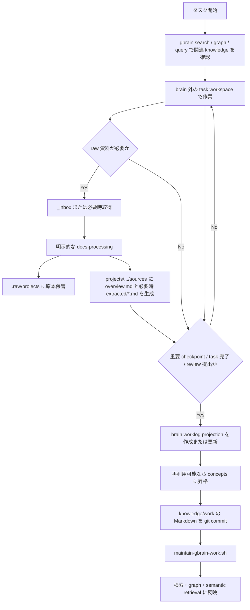

# Work Brain の一日運用ライフサイクル

## 結論

現時点では、scheduled 実行される処理はまだない。

実装済みなのは、初回構築、通常 maintenance、検証の3スクリプトである。通常 maintenance は自動化可能な形になっているが、OS scheduler には未登録である。

```text
初回だけ:
  bootstrap-gbrain-work.sh

日常:
  Agent / user が Markdown を更新
    -> git commit
    -> maintain-gbrain-work.sh

必要時:
  verify-gbrain-work.sh
```

ホスト確認結果:

| 項目 | 現在の状態 |
|---|---|
| launchd `com.gbrain.autopilot` | 未登録 |
| systemd `gbrain-autopilot.service` | 未登録 |
| gbrain autopilot wrapper | 未生成 |
| crontab の gbrain / agent-knowledge-base 関連 entry | なし |
| `gbrain autopilot --status --json` | `{"installed":false,"last_log":""}` |

## 役割分担

work brain は、すべてを自動処理する daemon ではない。Markdown knowledge を正として、coding agent が整理した知識を gbrain runtime が検索可能にする構成である。

| 層 | 責務 | 自動化状況 |
|---|---|---|
| task workspace | 実作業、`task.md`、途中経過、review 差し戻し | brain 外。運用設計済み、専用同期 skill は未実装 |
| `_inbox/` | user が未処理資料を雑に投入する入口 | フォルダのみ実装。自動監視なし |
| docs-processing | raw の分類、原本保管、Markdown 化 | user 指示を受けた coding agent が明示実行 |
| `knowledge/work/` | 整理済み Markdown knowledge | Git 管理対象 |
| `.raw/` | raw 原本アーカイブ | Git・gbrain index 対象外 |
| `.artifacts/` | Word、Excel、PowerPoint、PDF などの派生成果物 | Git・gbrain index 対象外 |
| `projects/.../sources/**/extracted/<file-stem>/` | docs-processing 済み Markdown | Git 管理対象 |
| `projects/.../sources/**/views/<scope>/` | 人間用 view | 中身の固定構造は設けない |
| gbrain PGLite DB | pages、chunks、links、timeline、embedding | Markdown から再生成できる derived cache |

## 初回構築

初回、または derived DB を作り直す場合だけ実行する。

```bash
scripts/knowledge/bootstrap-gbrain-work.sh
```

内部処理:

```text
ローカル ruri-v3 provider の probe
  -> PGLite DB を削除して再作成
  -> gbrain init
  -> schema pack 適用
  -> knowledge/work を source 登録
  -> full sync --no-embed
  -> wikilink edge 抽出
  -> timeline 抽出
  -> stale chunk embedding
  -> storage status
  -> doctor
```

注意点:

- `bootstrap-gbrain-work.sh` は `.gbrain-work/.gbrain` を削除する破壊的処理である。
- Markdown が system of record なので、DB は再構築できる。
- 日常運用では使わない。

## 一日の標準フロー



### 朝・タスク開始時

Agent は新しい作業を始める前に brain-first lookup を行う。

```text
1. gbrain search で project / source / worklog / concept を検索
2. 必要なら graph traversal で関連 page を辿る
3. 曖昧な検索だけ semantic query を使う
4. 参照した knowledge を task.md の Referenced Knowledge に記録
```

この lookup は read-only であり、毎回 embedding を作り直す処理ではない。

### 作業中

実作業は brain 内ではなく task workspace で進める。task workspace は operational state、brain worklog は再利用可能な knowledge projection である。

review 差し戻しがあった場合は、同じ task workspace を再利用する。brain worklog も同じページへ追記し、timeline に `reopened`、`review2`、`fixed` などを追加する。

### raw 資料が必要になった時

raw は闇雲に収集しない。必要になった時だけ取得し、取得と Markdown 化をセットで行う。

```text
user が _inbox/ に投入、または Agent が必要時に取得
  -> docs-processing を明示依頼
  -> 関連 project と資料カテゴリを推定
  -> checksum と論理資料名で重複・版違いを判定
  -> .raw/projects/.../<論理資料名>/ に最新版原本だけ保管
  -> projects/<project>/sources/.../overview.md を生成
  -> docs-processor の抽出結果を extracted/<file-stem>/*.md に保存
  -> 必要に応じて views/<scope>/yymmdd_<slug>.* に人間用 view を保存
  -> overview.md に raw_ref と関連 wikilink を記録
```

raw 原本は indexed knowledge に混ぜず、Markdown 化した `extracted/` と `views/` を source から辿れる状態にする。同一資料の版違い、再ダウンロード、コピー suffix 付きファイルは、論理資料単位に自動集約する。

### task 完了・重要 checkpoint 時

task workspace の内容を brain worklog に投影する。

```text
task.md
  -> summary
  -> referenced knowledge
  -> outputs
  -> reuse notes
  -> timeline
  -> projects/<project>/worklog/...md
```

複数タスクで再利用できる判断や手順だけを `concepts/` に昇格する。作業ログ全体を brain に入れない。

### Markdown 更新後

brain 側の Markdown を commit してから、通常 maintenance を実行する。

```bash
git add knowledge/work
git commit -m "docs: update work brain"
scripts/knowledge/maintain-gbrain-work.sh
```

内部処理:

```text
source-scoped sync --no-embed
  -> wikilink edge 再抽出
  -> timeline 再抽出
  -> stale chunk だけ embedding
  -> doctor
```

`maintain-gbrain-work.sh` は未 commit の `knowledge/work` 差分がある場合は停止する。Git commit が Markdown 正本の checkpoint になる。

## Scheduled 実行の整理

### 現時点で scheduled 実行されるもの

なし。

### v1 で追加する価値がある scheduled 実行

最初に追加するなら、1日1回の end-of-day reconciliation batch が妥当である。

```text
毎日夜間:
  task workspace の更新漏れを検出
    -> task worklog projection を作成または更新
    -> 必要な concepts を整理
    -> knowledge/work を commit
    -> maintain-gbrain-work.sh
    -> 結果がある時だけ通知
```

目的は、task 終了時の manual sync を置き換えることではない。中断、reopen、同期漏れを補正することである。

ただし、この batch はまだ実装されていない。task workspace の探索方法、同期 skill、commit 方針、通知先を決めてから scheduler に登録する。

### 必要なら追加できる scheduled 実行

| 候補 | 推奨タイミング | 現時点の扱い |
|---|---|---|
| `maintain-gbrain-work.sh` | knowledge 更新 commit 後、または夜間 batch の末尾 | 実装済み。scheduler 未登録 |
| `verify-gbrain-work.sh` | gbrain 更新後、規約変更後、障害調査時 | 手動実行を推奨 |
| `_inbox/` の未処理検出 | 1日1回程度 | 通知だけなら候補。自動 docs-processing はまだ行わない |
| task worklog reconciliation | 1日1回 | 次に実装する候補 |

## gbrain Autopilot との関係

vendored gbrain 自体には `gbrain autopilot --install` があり、macOS では launchd、Linux では systemd、必要に応じて cron へ常駐処理を登録できる。

upstream の autopilot / dream cycle は、sync、extract、embed に加えて、enrichment、facts extraction、synthesis、矛盾検出などの自律 maintenance を行うための仕組みである。

ただし、今回の work brain v1 では有効化しない。

理由:

- 外部 LLM を使わない local-only 方針である。
- docs-processing は user 指示を受けた human-in-the-loop 処理と決めている。
- task worklog reconciliation の skill がまだない。
- PGLite 単一ユーザー運用では、まず明示的な maintenance で十分である。
- autopilot を有効化すると、どの phase を動かすか、local model で代替できるか、通知と失敗時復旧をどうするかを別途設計する必要がある。

`doctor` が `cycle_freshness` を fail と表示するのは、autopilot / dream cycle をまだ回していないためである。現在のスクリプトは診断を表示するが、この fail だけで bootstrap や maintenance を中断しない。

## 現在の運用コマンド

| 用途 | コマンド |
|---|---|
| 初回構築・DB 再構築 | `scripts/knowledge/bootstrap-gbrain-work.sh` |
| 通常の差分反映 | `scripts/knowledge/maintain-gbrain-work.sh` |
| 検索・graph・除外ルールの検証 | `scripts/knowledge/verify-gbrain-work.sh` |
| upstream autopilot の状態確認 | `GBRAIN_HOME="$PWD/.gbrain-work" bun run gbrain/src/cli.ts autopilot --status --json` |

## 次に決めること

優先度順:

1. task workspace の実体パスと `task.md` の最低限フォーマット。
2. task workspace から brain worklog projection を作る skill。
3. task 終了時の manual sync 手順。
4. 1日1回の reconciliation batch の実装方法。
5. batch が Markdown を更新した場合の自動 commit 方針。
6. `_inbox/` の未処理資料を通知だけするか。
7. upstream autopilot / dream cycle を将来使うか。使う場合は local-only で許可する phase を限定する。

## 関連文書

- [Work GBrain Architecture](../../design/work-gbrain-architecture.md)
- [ADR-0001: Work document intake と GBrain 境界](../../adr/0001-work-document-intake-and-gbrain-boundary.md)
- [ADR-0002: Task workspace と brain worklog projection の分離](../../adr/0002-task-workspace-and-brain-worklog-projection.md)

**ドキュメント更新日**: 2026-05-31
